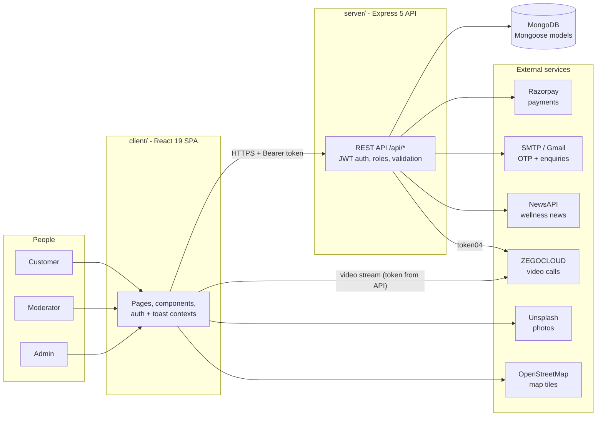
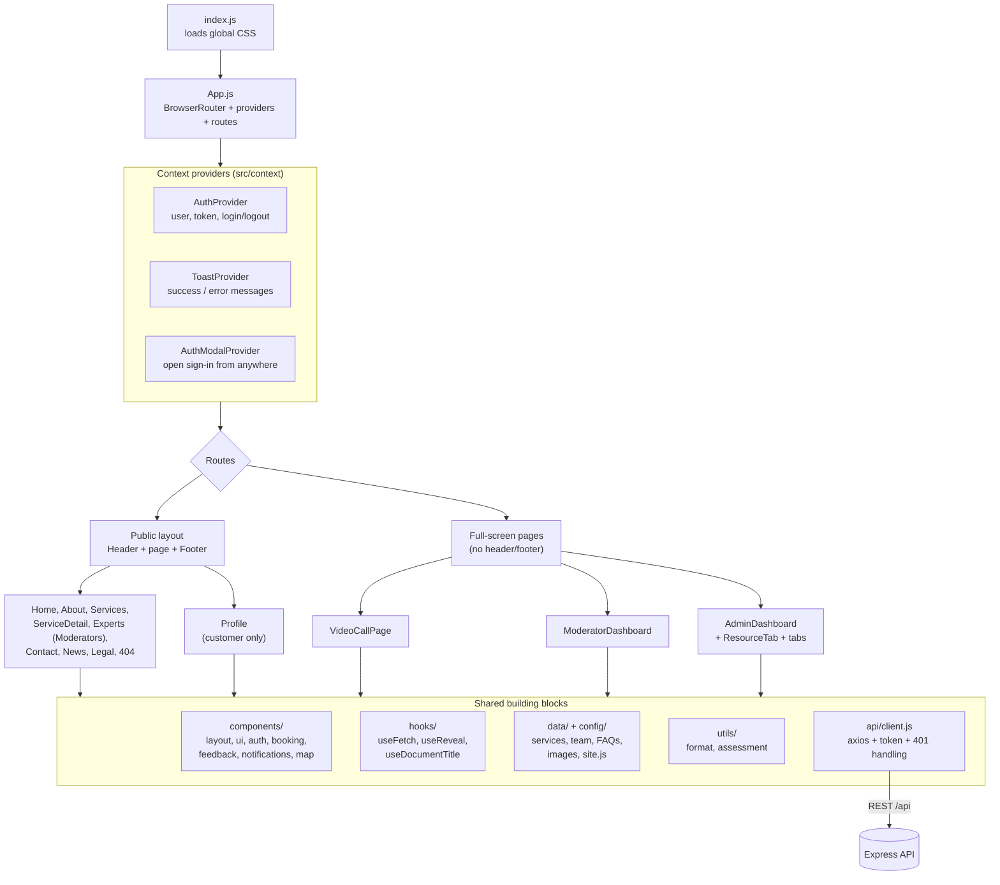
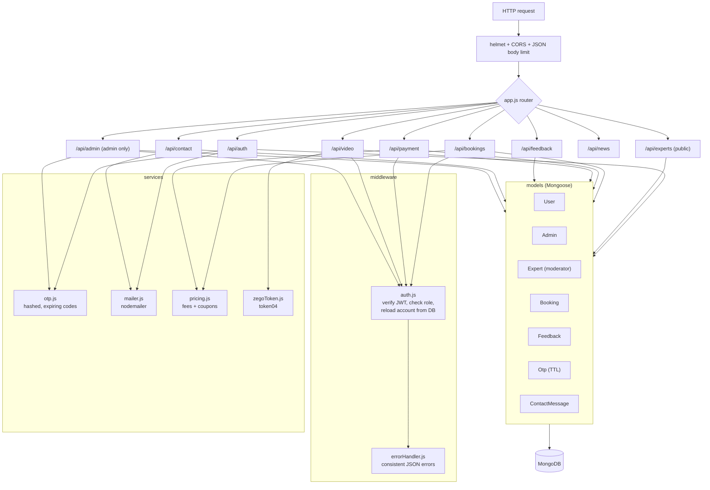
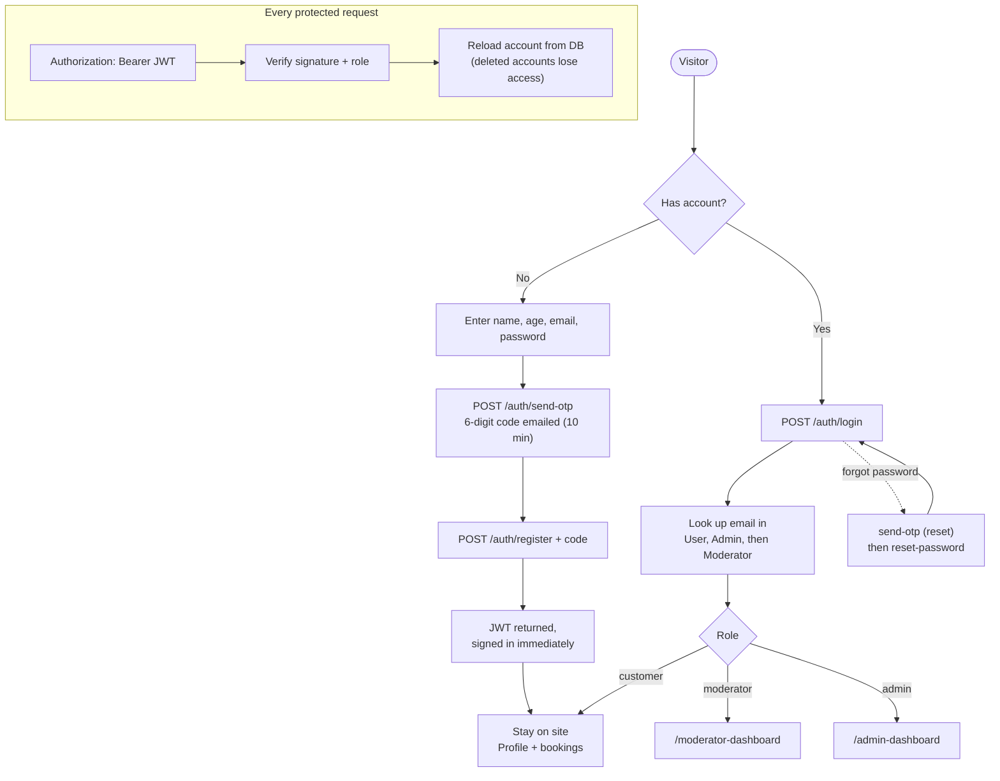
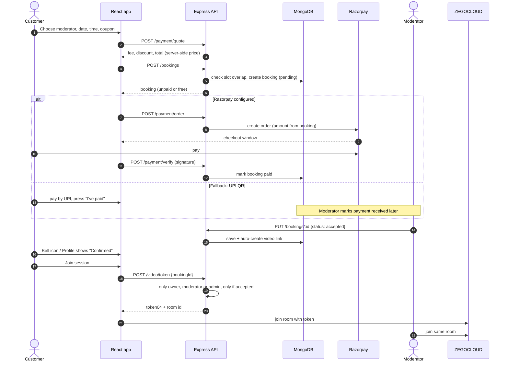
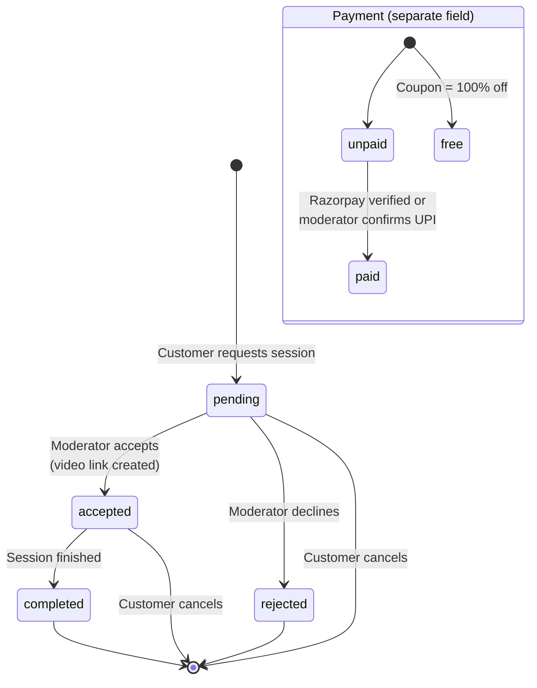
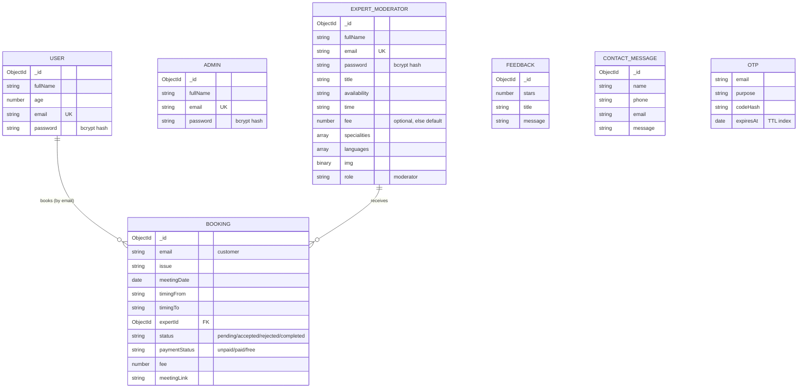
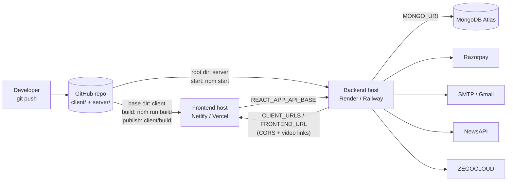

# Balanced Minds Consultancy

A full-stack website for a counselling and coaching practice. Visitors can explore services, find a moderator (counsellor / coach), book and pay for a session, and join it over video. Moderators manage their own bookings, and admins manage everything.

**Stack:** React 19 (Create React App) · Express 5 · MongoDB (Mongoose) · Razorpay · ZEGOCLOUD · NewsAPI

---

## Table of contents

1. [Overview](#1-overview)
2. [System architecture](#2-system-architecture)
3. [Frontend architecture](#3-frontend-architecture)
4. [Backend architecture](#4-backend-architecture)
5. [Folder structure](#5-folder-structure)
6. [Roles and permissions](#6-roles-and-permissions)
7. [Key flows](#7-key-flows) (authentication, booking and payment, booking status)
8. [Data model](#8-data-model)
9. [API reference](#9-api-reference)
10. [Getting started](#10-getting-started)
11. [Environment variables](#11-environment-variables)
12. [Deployment](#12-deployment)
13. [Customising the site](#13-customising-the-site)
14. [Security notes](#14-security-notes)
15. [Testing](#15-testing)
16. [Troubleshooting](#16-troubleshooting)

---

## 1. Overview

### What the site does

| Area | Features |
|---|---|
| **Public website** | Home, About, 9 service pages, Contact (form + map), wellness news, Privacy / Terms, 404 |
| **Customers** | Register with email OTP, sign in, book sessions, apply coupons, pay online or by UPI, see status and joining link, edit profile, cancel bookings, give feedback |
| **Moderators** | Appear on the public page, accept / decline / complete their own bookings, mark UPI payments received, join video calls |
| **Admins** | Dashboard with stats and charts; manage users, moderators, admins, feedback, contact messages and bookings |
| **Extras** | 2-minute wellness check-in, in-app session reminders, WhatsApp / call buttons, responsive design, scroll animations |

### Roles at a glance

```text
Customer  -> uses the public site, books sessions
Moderator -> delivers sessions, manages own bookings   (stored in the "Expert" collection)
Admin     -> manages the whole platform
```

---

## 2. System architecture



**How it fits together:** the React app talks only to the Express API (`/api/*`). The API owns all business rules (prices, coupons, slot clashes, who may join a call) and is the only part that touches the database and the secret keys.

---

## 3. Frontend architecture



Design decisions:

* **One design system, no UI framework.** Colours, spacing and type live in `styles/tokens.css`; components and pages build on them. Everything is mobile-first.
* **Data-driven services.** All 9 service pages come from `data/services.js` through one `ServiceDetailPage`.
* **Protected routes.** `ProtectedRoute` checks the signed-in role; the API re-checks it on every request.
* **Code splitting.** Admin, moderator and video pages are lazy-loaded, so the public site stays light.
* **Resilient images.** `SmartImage` shows a branded gradient if a photo fails to load.

---

## 4. Backend architecture



Layers: **routes** (HTTP + validation) → **middleware** (auth, errors) → **services** (reusable logic) → **models** (database). Secrets are read once in `config/env.js`, and the server refuses to start without `MONGO_URI` and `JWT_SECRET`.

---

## 5. Folder structure

```text
balanced-minds-consultancy/
├── README.md
├── package.json                  # helper scripts for the whole repo
├── .gitignore                    # .env files are ignored
├── docs/diagrams/                # source (.mmd) and rendered (.png) diagrams
│
├── client/                       # React app
│   ├── public/                   # index.html, logo, favicons, _redirects, robots.txt
│   └── src/
│       ├── index.js · App.js     # entry point, routes, providers
│       ├── api/client.js         # axios instance (token, 401 handling)
│       ├── config/site.js        # brand, contact details, PROVIDER label
│       ├── context/              # AuthContext, ToastContext, AuthModalContext
│       ├── data/                 # services, team, faqs, images
│       ├── hooks/                # useFetch, useReveal, useDocumentTitle
│       ├── utils/                # format helpers, wellness scoring (+ tests)
│       ├── styles/               # tokens, base, components, layout, pages, dashboard
│       ├── components/
│       │   ├── layout/           # Header, Footer, Layout, ScrollToTop
│       │   ├── ui/               # Modal, SmartImage, Accordion, ContactForm, ...
│       │   ├── auth/             # AuthModal, ProtectedRoute
│       │   ├── booking/          # BookingModal (details, payment, confirmation)
│       │   ├── feedback/         # testimonials + feedback form
│       │   ├── notifications/    # "Your sessions" drawer
│       │   ├── assessment/       # wellness check-in
│       │   └── map/              # Leaflet map
│       └── pages/
│           ├── Home, About, Services, ServiceDetail, Experts,
│           │   Contact, News, Profile, VideoCall, Legal, NotFound
│           ├── admin/            # AdminDashboard, ResourceTab, tabs
│           └── moderator/        # ModeratorDashboard
│
└── server/                       # Express API
    ├── .env.example
    └── src/
        ├── server.js · app.js    # start-up, middleware, route mounting
        ├── config/               # env.js (validation), db.js
        ├── middleware/           # auth.js, errorHandler.js
        ├── models/               # User, Admin, Expert, Booking, Feedback, Otp, ContactMessage
        ├── routes/               # auth, experts, bookings, payment, video,
        │                         # feedback, contact, news, admin
        ├── services/             # mailer, otp, pricing, zegoToken
        ├── utils/                # asyncHandler, httpError, validators
        └── scripts/seedAdmin.js  # creates the first admin
```

---

## 6. Roles and permissions

| Action | Visitor | Customer | Moderator | Admin |
|---|:--:|:--:|:--:|:--:|
| Browse pages, moderators, news | ✅ | ✅ | ✅ | ✅ |
| Send a contact message / feedback | ✅ | ✅ | ✅ | ✅ |
| Register, sign in, reset password | ✅ | – | – | – |
| Book a session | ❌ | ✅ | ❌ | ❌ |
| See and cancel own bookings | ❌ | ✅ | ❌ | ❌ |
| See and manage bookings for **own** profile | ❌ | ❌ | ✅ | ✅ (all) |
| Join a video session | ❌ | own booking, once accepted | own bookings, once accepted | ✅ |
| Manage users, moderators, admins, feedback, messages | ❌ | ❌ | ❌ | ✅ |

The role comes from the JWT, and the API reloads the account from the database on every request. A deleted account loses access immediately.

---

## 7. Key flows

### 7.1 Registration and sign-in



### 7.2 Booking, payment and video session



### 7.3 Booking and payment status



---

## 8. Data model



Notes: moderators live in the `Expert` collection (every record has `role: "moderator"`). `Otp` documents delete themselves after expiry. Photos are stored on the moderator and streamed from `/api/experts/:id/photo`.

---

## 9. API reference

All routes are under `/api`. 🔓 = public, 👤 = customer, 🛡️ = moderator, 👑 = admin.

| Method & path | Access | Purpose |
|---|:--:|---|
| `GET /health` | 🔓 | Health check |
| **Auth** | | |
| `POST /auth/send-otp` | 🔓 | Email a code (`purpose`: `register` or `reset`) |
| `POST /auth/register` | 🔓 | Create account with code, returns token |
| `POST /auth/login` | 🔓 | Sign in (customer, moderator or admin) |
| `POST /auth/reset-password` | 🔓 | Set a new password with code |
| `GET /auth/me` | any signed in | Current account (restores session) |
| `GET` / `PUT /auth/profile` | 👤 | Read / update own name and age |
| **Moderators (public)** | | |
| `GET /experts` · `GET /experts/:id` | 🔓 | Public profiles (no email or password) |
| `GET /experts/:id/photo` | 🔓 | Profile photo |
| **Bookings** | | |
| `POST /bookings` | 👤 | Request a session (price and clashes checked on server) |
| `GET /bookings/mine` | 👤 | Own bookings |
| `GET /bookings` | 🛡️ 👑 | Moderator: own; admin: all |
| `PUT /bookings/:id` | 🛡️ 👑 | Change status, notes, link, payment received |
| `DELETE /bookings/:id` | 👤 👑 | Cancel (customer: own only) |
| **Payment** | | |
| `GET /payment/config` | 🔓 | Is Razorpay enabled? |
| `POST /payment/quote` | 👤 | Price with coupon |
| `POST /payment/order` | 👤 | Create Razorpay order for a booking |
| `POST /payment/verify` | 👤 | Verify signature, mark paid |
| **Video** | | |
| `POST /video/token` | signed in | ZEGO token for an accepted booking you belong to |
| **Content** | | |
| `GET` / `POST /feedback` | 🔓 | Testimonials (no emails) / submit feedback |
| `POST /contact` | 🔓 | Contact form (saved + emailed) |
| `GET /news?q=` | 🔓 | Wellness news (cached 10 min) |
| **Admin** (`/admin/...`) | 👑 | |
| `GET /stats` | 👑 | Dashboard numbers |
| `GET /users` · `POST` · `PUT /:id` · `DELETE /:id` | 👑 | Manage customers |
| `GET /moderators` · `POST` · `PUT /:id` · `DELETE /:id` | 👑 | Manage moderators (multipart for photo) |
| `GET /admins` · `POST /admins/invite` · `POST /admins/confirm` · `PUT` / `DELETE /admins/:id` | 👑 | Admins (new admin needs approval code; last admin cannot be deleted) |
| `GET /feedbacks` · `PUT` / `DELETE /:id` | 👑 | Moderate feedback |
| `GET /messages` · `DELETE /:id` | 👑 | Contact messages |
| `GET /bookings` · `DELETE /:id` | 👑 | All bookings |

Errors are always JSON: `{ "message": "..." }`.

---

## 10. Getting started

**Requirements:** Node.js 18+, a MongoDB database (local or Atlas).

```bash
# 1. install everything
npm run install:all

# 2. create your environment files
cp server/.env.example server/.env     # set MONGO_URI and JWT_SECRET at minimum
cp client/.env.example client/.env     # REACT_APP_API_BASE=http://localhost:5000

# 3. create the first admin (set ADMIN_EMAIL and ADMIN_PASSWORD in server/.env first)
npm run seed:admin

# 4. start both apps (two terminals)
npm run dev:server     # API  -> http://localhost:5000
npm run dev:client     # site -> http://localhost:3000
```

Without email credentials, OTP codes are printed in the server console (development only). Without Razorpay keys, the booking screen uses the UPI QR fallback.

| Script (repo root) | Does |
|---|---|
| `npm run install:all` | Installs `server` and `client` dependencies |
| `npm run dev:server` / `dev:client` | Starts each app in development |
| `npm run build` | Production build of the frontend |
| `npm run seed:admin` | Creates the first admin account |

---

## 11. Environment variables

### `server/.env`

| Variable | Required | Description |
|---|:--:|---|
| `MONGO_URI` | ✅ | MongoDB connection string |
| `JWT_SECRET` | ✅ | Long random string used to sign login tokens |
| `PORT` | – | Default `5000` |
| `JWT_EXPIRES_IN` | – | Default `8h` |
| `CLIENT_URLS` | prod | Allowed frontend origins (comma separated) |
| `FRONTEND_URL` | prod | Public site URL (used in video links) |
| `EMAIL_USER`, `EMAIL_PASS` | for email | Gmail address + **app password** |
| `SMTP_HOST`, `SMTP_PORT`, `SMTP_USER`, `SMTP_PASS` | alt. | Any SMTP provider (overrides Gmail) |
| `CONTACT_INBOX` | – | Where contact-form emails go |
| `ADMIN_NAME`, `ADMIN_EMAIL`, `ADMIN_PASSWORD` | seed | Used only by `npm run seed:admin` |
| `RAZORPAY_KEY_ID`, `RAZORPAY_SECRET` | – | Enables online payments |
| `DEFAULT_SESSION_FEE` | – | Fee when a moderator has none (default 1000) |
| `COUPONS` | – | `CODE:PERCENT` pairs, e.g. `WELCOME:20,AMAN:100` |
| `ZEGO_APP_ID`, `ZEGO_SERVER_SECRET` | video | ZEGOCLOUD credentials (**server only**) |
| `NEWS_API_KEY` | news | newsapi.org key |
| `BUSINESS_TZ_OFFSET` | – | Default `+05:30` (used to reject past bookings) |

### `client/.env`

| Variable | Description |
|---|---|
| `REACT_APP_API_BASE` | API URL, e.g. `http://localhost:5000` |
| `REACT_APP_CONTACT_EMAIL`, `_PHONE`, `REACT_APP_WHATSAPP_NUMBER`, `REACT_APP_UPI_ID` | Optional overrides for the details in `config/site.js` |

---

## 12. Deployment



Checklist:

1. Deploy the **server** first and set all its environment variables.
2. Deploy the **client** with `REACT_APP_API_BASE` pointing to the server URL.
3. Set `CLIENT_URLS` and `FRONTEND_URL` on the server to the final site URL.
4. Run `npm run seed:admin` once (a shell on the host, or locally against the production `MONGO_URI`).
5. `client/public/_redirects` already makes deep links (e.g. `/services/reiki`) work on Netlify.

---

## 13. Customising the site

| I want to change... | Edit |
|---|---|
| Brand name, phone, email, address, hours, UPI ID, map position | `client/src/config/site.js` |
| What moderators are called ("Moderator") | `PROVIDER` in `client/src/config/site.js` |
| Service names, text, icons | `client/src/data/services.js` (a new entry gets its own page automatically) |
| Team members, FAQs | `client/src/data/team.js`, `faqs.js` |
| Photos | `client/src/data/images.js` (use your own files in `client/public/images/` if you prefer) |
| Colours, fonts, spacing | `client/src/styles/tokens.css` |
| Logo and favicon | `client/public/logo.svg`, `favicon.svg` |
| Wellness check-in questions and result bands | `client/src/utils/assessment.js` |

---

## 14. Security notes

* Passwords are hashed with bcrypt; login errors never reveal whether an email exists.
* OTP codes are random, hashed, expire after 10 minutes and allow 5 attempts.
* Rate limits protect sign-in, OTP and contact endpoints.
* Prices, coupons and payment signatures are decided and verified on the server only.
* Video tokens are generated on the server; the ZEGO secret never reaches the browser.
* Admin and moderator routes check the role on every request.
* **Never commit `.env` files.** The included `.gitignore` excludes them. If credentials were ever pushed to a public repository, rotate them all.

---

## 15. Testing

```bash
cd client && npm test      # unit tests for formatting and the wellness check-in scoring
```

Manual checklist after deploying: register with OTP → book with a coupon → accept as moderator → join the call from both accounts → mark complete → create and delete a moderator as admin.

---

## 16. Troubleshooting

| Problem | Likely cause and fix |
|---|---|
| Server exits at start | `MONGO_URI` or `JWT_SECRET` missing in `server/.env` |
| Browser shows CORS errors | Add the site URL to `CLIENT_URLS` on the server |
| Razorpay "Authentication failed" | Key ID and secret do not match, are inactive, or mix test and live keys. The booking screen falls back to UPI meanwhile |
| OTP email never arrives | Use a Gmail **app password**, or an SMTP provider; check the spam folder |
| Moderator cannot sign in | Admin → Moderators → Edit → **Reset password**, then sign in with the new password |
| Video call will not open | Check `ZEGO_APP_ID` / `ZEGO_SERVER_SECRET`, and that the booking status is *Confirmed* |
| News page empty | `NEWS_API_KEY` missing or over its daily limit |
| Photos missing | Unsplash links are blocked or removed; a gradient shows instead. Replace them in `data/images.js` |
